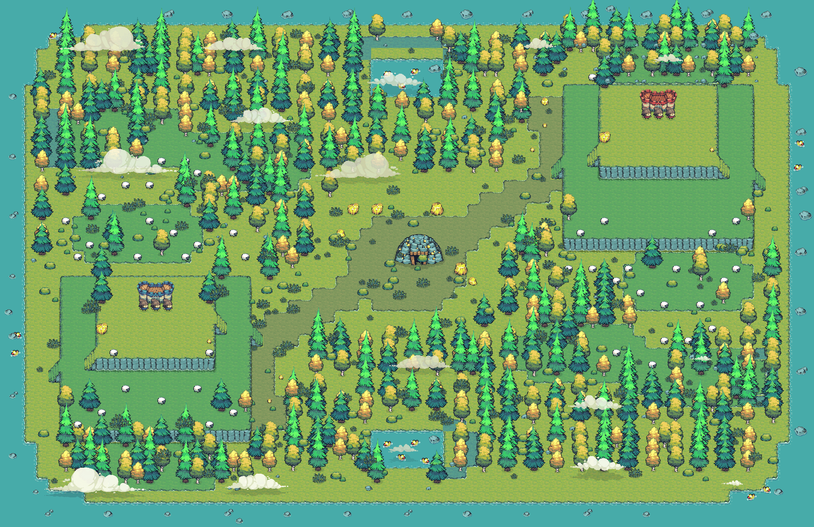

# Two Kingdoms — map rộng với mỏ vàng trên đất phẳng

Mở lại `Assets/Scenes/Map.unity` và nhấn Play.

[Xem cận cảnh cây, cỏ và cừu ở hai tầng Castle Blue](Blue-terrace-scenery.png)

## Bố cục hiện tại

- Map 68 × 44 ô, rộng hơn 8 ô theo chiều ngang so với bản 60 × 44. Tile Tiny Swords vẫn giữ
  nguyên kích thước 64 × 64 pixel.
- Nền Castle mỗi phe có tầng dưới 16 × 13 ô và tầng trên 10 × 7 ô. Castle Blue ở
  `(13, 19.5)`, Castle Red ở `(55, 35.5)`. Mỗi bên vẫn bắt đầu với 3 Pawn.
- Hai Castle đứng ở độ cao 2. Mỗi tầng có một hàng vách riêng, cách nhau bằng
  khoảng sân tầng dưới. Mỗi căn cứ có hai lối lên ở hai phía; mỗi lối gồm hai
  đoạn dốc nối từ mặt đất qua tầng dưới đến sân Castle. Cả hai lối đều dùng được
  độc lập, vẫn còn ít nhất 171 ô trống ở Blue và 180 ô ở Red để đi lại và xây dựng.
- Mỏ vàng 2 × 2 tại `(34,21)` nằm trên đất phẳng ở giữa đảo. Các tầng đồi,
  bóng đổ và dốc cũ quanh mỏ đã được gỡ bỏ; quân tiếp cận từ hai phía.
- Có 51 cừu: Blue giữ 12 con ở phía bắc đồi và 1 con ở phía nam; Red giữ
  12 con ở phía nam và 1 con ở phía bắc. Mỗi bãi ngoài thay 11 con bằng cây.
  Vẫn có 12 con ở đồng trung lập, 4 con tại các góc ngoài tầng dưới mỗi phe
  và 5 con trên hai sân Castle Blue.
- Mỗi căn cứ có 2 cây ở rìa phía trên của tầng dưới, bên ngoài sân Castle,
  và 2 cây ở các góc rìa tầng dưới.
  Rìa sân tầng trên có 1 đá vàng lớn và 1 đá vàng nhỏ, cân bằng giữa hai phe.
  Các cụm tài nguyên tránh sân giữa và hai lối lên.
- Castle Blue có thêm 2 thông sẫm Tree1 trên mỗi tầng và 4 cụm cỏ Bushe3,
  mỗi cụm gồm 3 bụi sát nhau, đặt gần rìa. Cỏ chỉ trang trí, không cản đường.
- Mỗi bãi ngoài phía nam Blue và phía bắc Red có thêm 27 cây khai thác được,
  bố trí đối xứng, dùng 4 cặp cây/gốc Tiny Swords đã có. Các cụm rừng trải khắp
  đảo nhưng vẫn chừa lối đi và ô đứng để khai thác. Có 64 đá nhỏ cạnh rừng và
  12 đá ven bờ, cùng 48 đá trên nước
  có hoạt ảnh sóng và 16 cụm mây nằm trong map.
- Mây lớn hơn khoảng 1,6–1,8 lần, bay chậm qua lại theo chu kỳ 48–78 giây.
  Mỗi hồ có một cụm mây nhẹ, các cụm khác bay trên rừng và đất ven bờ. Cả cụm
  mây luôn nằm trong ranh giới map, không cản chọn lính hoặc đường di chuyển.
- Có 16 vịt cao su từ bộ Tiny Swords: 8 con ở hai hồ và 8 con ven biển.
  Vịt dùng hoạt ảnh nổi trên nước gồm 3 khung hình; chỉ để trang trí, không
  phải tài nguyên thức ăn và không cản đường.
- Mỏ vẫn chứa 2.000 Gold; 6 đá vàng giữa map chứa tổng cộng 2.400 Gold.
  Thông số chiến đấu, khai thác, xây dựng và hoạt ảnh giữ nguyên.
- Sau khi thay cừu bằng cây, cần kiểm tra lại khả năng tiếp cận từng nút tài
  nguyên và đường từ cả hai Castle tới mỏ giữa bằng validator của map.

## Chỉnh sửa và kiểm tra

`Assets/Data/TwoKingdomsLayout.asset` chứa vị trí Castle, Pawn và tài nguyên.
`BattlefieldLayout.Width/Height` quy định kích thước map; `BattlefieldTerraces`
quy định bốn nền của hai căn cứ và các cặp ô lên xuống. Camera, mức thu phóng, địa hình,
đường đi và Fog of War đều dùng kích thước map mới.

Menu **Tools → Tiny Kingdom → Build Two Kingdoms Battlefield** dựng lại bố
cục mặc định và ghi đè placement/trang trí của map này. Lưu bản sao trước nếu
đã chỉnh tay. `Battlefield_EditorPreview` chỉ hiện ngoài Play Mode.

Kiểm tra tự động bao gồm đường tới mỏ của hai phe, khả năng tiếp cận từng
nút tài nguyên, các bãi cừu còn lại và hai rừng ngoài, khoảng sân xây dựng
trống, hai tầng Castle,
hai lối lên độc lập (chặn một lối để kiểm tra lối còn lại), địa hình phẳng ở mỏ,
kích thước camera, Fog of War, số lượng cảnh vật và vị trí/khung hình hoạt ảnh
của vịt, đá nước trong Play Mode. Kiểm tra mây gồm giới hạn toàn bộ hình trong
map suốt hai chu kỳ, vị trí trên hai hồ và chuyển động thực tế trong Play Mode.
Map giữ nguyên Fog of War và chưa bổ sung bộ chỉ huy AI cho Red.
